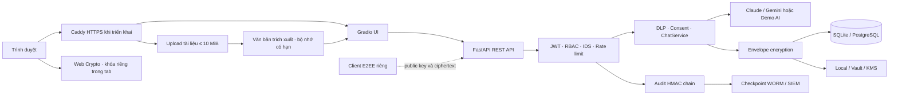

<div align="center">

# 🛡️ SCAP

### Secure Conversational Application Platform

**Nền tảng trò chuyện AI đa người dùng · Bảo mật ứng dụng và hệ thống**

Từ đăng nhập, phân quyền và kiểm soát dữ liệu đến mã hóa, giám sát và xử lý sự cố.

[](pyproject.toml)
[](src/app/main.py)
[](src/app/gradio_ui.py)
[](uv.lock)
[](.github/workflows/security.yml)

[Chạy demo](#chay-demo) · [Giao diện](#giao-dien) · [Triển khai](#trien-khai) · [Tài liệu](#tai-lieu)

</div>

> **Bắt đầu nhanh:** `uv sync --frozen --group dev` → `uv run --frozen python -m scripts.demo_local` → mở [http://127.0.0.1:8000](http://127.0.0.1:8000).
> Launcher tự tạo dữ liệu và khóa tạm, nạp tài khoản mẫu, dùng AI ngoại tuyến. Không cần Docker, API key hay sửa `.env`.

## Mục lục

- [Tính năng](#tong-quan)
- [Chạy demo](#chay-demo)
- [Tài khoản và kịch bản demo](#tai-khoan-demo)
- [Giao diện](#giao-dien)
- [Đính kèm tài liệu trong chat](#dinh-kem)
- [Mã hóa/giải mã trong trình duyệt](#ma-hoa-trinh-duyet)
- [Vai trò và chế độ bảo mật](#vai-tro)
- [Kiến trúc và các lớp bảo vệ](#kien-truc)
- [Chạy local có lưu dữ liệu](#local)
- [Triển khai: Docker, VPS, high-security](#trien-khai)
- [REST API](#api)
- [Kiểm thử và CI](#kiem-thu)
- [Cấu hình](#van-hanh)
- [Cấu trúc mã nguồn](#ma-nguon)
- [Xử lý lỗi thường gặp](#xu-ly-loi)
- [Giới hạn và tài liệu](#tai-lieu)

<a id="tong-quan"></a>
## Tính năng

**SCAP** là đồ án môn **Bảo mật Ứng dụng và Hệ thống**, viết bằng FastAPI, Gradio 6 và SQLAlchemy. Ứng dụng đặt các kiểm soát an ninh vào cùng một luồng sử dụng: đăng nhập → tạo hội thoại → kiểm tra dữ liệu → gọi AI → mã hóa lưu trữ → ghi nhật ký kiểm toán.

- **Trò chuyện:** nhiều hội thoại; đổi tên, xóa, tìm kiếm theo quyền sở hữu, xuất JSON và xem bản mã của từng tin nhắn.
- **Đính kèm tài liệu:** tệp văn bản, mã nguồn, `.docx` hoặc `.pdf` tối đa **10 MB**. Tài liệu dài được chọn đoạn liên quan tới câu hỏi trước khi gửi AI ([chi tiết](#dinh-kem)).
- **Kiểm soát AI:** Claude, Gemini hoặc AI demo; người dùng phải đồng ý trước khi gửi dữ liệu ra ngoài. DLP cho phép, che, yêu cầu xác nhận, chặn hoặc chỉ xử lý local. Tra cứu Internet có dẫn nguồn (Gemini) chỉ dùng cho hội thoại Public và mặc định tắt.
- **Bảo vệ tài khoản:** Argon2id; JWT gắn phiên phía máy chủ; TOTP và recovery code; passkey WebAuthn cho đăng nhập và xác thực lại; email khôi phục; smart lockout; quản lý thiết bị.
- **Cảnh báo tài khoản:** Web Push, xác minh số điện thoại qua SMS, phát hiện di chuyển bất thường bằng GeoIP local. Demo dùng outbox thay cho nhà cung cấp thật.
- **Bảo vệ dữ liệu:** AES-256-GCM, mỗi hội thoại một DEK riêng, AAD gắn với từng tin nhắn. Khóa được bọc bởi Local, Vault Transit, AWS KMS hoặc GCP KMS.
- **Mã hóa cục bộ:** tạo và trao đổi public key, mã hóa/giải mã văn bản và tệp tới 5 MiB ngay trong trình duyệt. Nội dung không đi qua API hay AI.
- **E2EE:** Private E2EE 1:1 (Olm/Double Ratchet qua `vodozemac`) và nhóm MLS (OpenMLS) bằng client terminal; server chỉ chuyển ciphertext.
- **Giám sát:** IDS/IPS theo chữ ký và tương quan bất thường, audit HMAC chain, checkpoint WORM, sự kiện JSON cho SIEM, dashboard ngân sách tài nguyên.
- **Triển khai:** demo tạm trên laptop, local có dữ liệu lâu dài, Docker với PostgreSQL/Redis/Caddy, hồ sơ VPS nhỏ và hồ sơ high-security.

<a id="chay-demo"></a>
## Chạy demo

Cần **Git**, **Python 3.10+** (CI và Docker dùng 3.12) và **[uv](https://docs.astral.sh/uv/getting-started/installation/)**. Node.js chỉ cần khi chạy bộ test JavaScript. Lần cài thư viện đầu tiên cần Internet.

```powershell
git clone https://github.com/nguyentuanthien2384/Secure_Conversational_Application_Platform.git
cd Secure_Conversational_Application_Platform
uv sync --frozen --group dev

uv run --frozen python -m scripts.demo_local --check   # kiểm tra UI/API rồi thoát
uv run --frozen python -m scripts.demo_local           # mở demo
```

- **Giao diện:** [http://127.0.0.1:8000](http://127.0.0.1:8000) · **Swagger:** [/docs](http://127.0.0.1:8000/docs).
- **Passkey:** mở [http://localhost:8000](http://localhost:8000), vì WebAuthn cần tên miền.
- **Cổng bận:** thêm `--port 8080`. **Dừng:** `Ctrl+C`; lần chạy sau là một lượt demo mới.

Launcher bỏ qua `.env`, chỉ nghe trên loopback, ép AI ngoại tuyến và không động tới database local đang có. Mã xác minh email nằm trong file `.eml` ở thư mục outbox in ra lúc khởi động. Hướng dẫn từng bước: [HUONG_DAN_CHAY.md](HUONG_DAN_CHAY.md).

**Demo E2EE và MLS** (tùy chọn):

```powershell
uv sync --frozen --group dev --extra e2ee-client
uv run --frozen --extra e2ee-client python -m scripts.demo_e2ee --check   # hai client 1:1

docker build -t scap-mls-client:local clients/mls_native                  # cần Docker (Linux containers)
uv run --frozen --extra e2ee-client python -m scripts.demo_mls --check    # nhóm ba client
```

Runner E2EE đăng ký hai client, đối chiếu fingerprint, gửi/giải mã hai chiều và kiểm tra export của server chỉ chứa ciphertext. Runner MLS kiểm tra thêm/xóa thành viên, đổi epoch và xác nhận người bị loại không đọc được tin mới. Kết quả nằm trong `reports/`. Xem [kịch bản E2EE](docs/DEMO_SCRIPT.md#demo-private-e2ee-voi-hai-client) và [client MLS](clients/mls_native/README.md).

<a id="tai-khoan-demo"></a>
## Tài khoản và kịch bản demo

**Mật khẩu mẫu dùng chung:** `Phenikaa-Vault#2026-Lab`.

| Tài khoản | Vai trò | Dùng để xem |
|---|---|---|
| `demo.user` | user | trò chuyện, đính kèm tài liệu, bản mã, tìm kiếm, bảo mật tài khoản |
| `demo.mod` | moderator | thêm nhật ký kiểm toán và giám sát IDS |
| `demo.boss` | admin | thêm dashboard, quản lý tài khoản, xác minh audit, danh sách chặn |

Launcher còn nạp 8 tài khoản `lab.*` cùng hội thoại và cảnh báo mẫu. Các sự kiện này là **mô phỏng**, không phải tấn công thật. Mật khẩu trên là dữ liệu công khai cho học tập: production từ chối `SEED_DEMO_DATA=true`, còn VPS tạo các tài khoản này bằng [seed_vps_accounts.py](scripts/seed_vps_accounts.py) với mật khẩu riêng.

**Luồng trải nghiệm đề xuất:**

1. Đăng nhập `demo.user`, chọn hội thoại có sẵn hoặc bấm **+ Hội thoại mới**.
2. Gửi một câu hỏi; phản hồi có nhãn **DEMO AI** khi không dùng provider thật.
3. Gửi một email mẫu để thấy DLP che dữ liệu, rồi mở **Dữ liệu mã hóa** xem ciphertext, nonce, key version.
4. Đính kèm một tài liệu `.pdf`, `.docx` hoặc `.csv` và hỏi về nội dung của nó.
5. Thử tạo cặp khóa và mã hóa văn bản/tệp bằng [công cụ trình duyệt](#ma-hoa-trinh-duyet).
6. Vào **Tài khoản** để xem thiết bị, hoạt động bảo mật, bật TOTP hoặc passkey.
7. Đăng nhập `demo.mod` / `demo.boss` để xem audit và cảnh báo.

Kịch bản trình bày 6 và 12 phút: [DEMO_SCRIPT.md](docs/DEMO_SCRIPT.md).

<a id="giao-dien"></a>
## Giao diện

Giao diện tiếng Việt, có chế độ sáng/tối và dùng được trên màn hình nhỏ.


- **Đăng nhập:** ba luồng Đăng nhập, Tạo tài khoản, Quên mật khẩu; đo độ mạnh mật khẩu; bước TOTP/recovery code khi bật 2FA. Thanh trên cùng hiện tài khoản, vai trò và thời gian phiên còn lại.
- **Trò chuyện:** thanh bên chọn hội thoại; tạo nhanh với mặc định Secure/Internal hoặc mở **Thiết lập hội thoại mới**; gửi bằng Enter; đính kèm tài liệu; sao chép phản hồi; tìm trong hội thoại; đổi tên, xuất, xóa.
- **Dữ liệu mã hóa:** ciphertext, nonce, crypto epoch, thuật toán, loại nhà cung cấp khóa, cùng công cụ mã hóa cục bộ.
- **Tìm kiếm:** tìm trong mọi hội thoại thuộc tài khoản, có phân trang.
- **Tài khoản:** mật khẩu, TOTP, đồng thuận AI, thiết bị, email khôi phục, passkey, hoạt động bảo mật.
- **Quản trị** (admin), **Nhật ký kiểm toán** và **Bảo mật** (moderator/admin): thống kê, dashboard khả dụng, quản lý tài khoản, IDS, xác minh chuỗi audit, gỡ chặn nguồn.

Bấm **Gửi** được xem là đồng ý gửi tin nhắn tới AI bên ngoài: lần gửi đầu tiên (hoặc sau khi đổi `AI_CONSENT_VERSION`) tự lưu consent cho tài khoản, có ghi audit, không cần bấm xác nhận thêm. Tắt ô đồng ý trong tab **Tài khoản** để thu hồi; lần gửi sau, AI chỉ nhận lịch sử kể từ lúc đó. Thông báo lỗi/DLP hiện ngay dưới ô nhập. Phản hồi AI hiển thị dạng văn bản, không thực thi HTML hay tải nội dung từ đường dẫn AI trả về. Mọi quyền ở giao diện được kiểm tra lại tại API; admin cũng chỉ đọc được hội thoại của chính mình.

<a id="dinh-kem"></a>
## Đính kèm tài liệu trong chat

Bấm **📎 Đính kèm tệp tài liệu** dưới ô nhập, chọn tệp, rồi đặt câu hỏi (hoặc bấm **Gửi** ngay để yêu cầu phân tích tệp).

- **Định dạng:** văn bản và dữ liệu (`.txt .md .csv .tsv .json .jsonl .xml .yaml .yml .log .ini .toml .cfg .conf .sql .html .css`), mã nguồn (`.py .js .ts .tsx .jsx .sh .bat .ps1 .c .cpp .h .hpp .java .go .rs .rb .php`) Word `.docx` và `.pdf`. Tệp văn bản phải là UTF-8 hoặc UTF-16 có BOM. PDF phải có lớp chữ (chọn/copy được chữ): bản scan/ảnh chụp bị từ chối vì chưa có OCR, PDF đặt mật khẩu mở tệp cũng bị từ chối (PDF chỉ chặn in/sửa vẫn đọc được). Mỗi trang được đánh dấu `[Trang N]` để AI trích dẫn đúng trang.
- **Dung lượng:** tối đa **10 MB** mỗi tệp. Trình duyệt hiện tiến độ tải lên.
- **Tài liệu dài:** mỗi tin nhắn gửi AI tối đa 30.000 ký tự từ tài liệu. Tài liệu dài hơn không bị cắt cụt; hệ thống chọn các đoạn liên quan nhất tới câu hỏi (xếp hạng BM25, khớp cả khi gõ không dấu) và luôn giữ đoạn mở đầu. Để trống câu hỏi thì lấy các đoạn rải đều toàn tài liệu. Cả banner lẫn tin nhắn đều ghi rõ đó là trích đoạn, nên hãy hỏi cụ thể (tên mục, từ khóa, số liệu).
- **Sau khi gửi:** tệp được gỡ khỏi ô soạn tin; phần nội dung đã gửi nằm trong tin nhắn và được mã hóa lưu trữ như mọi tin nhắn. Muốn hỏi phần khác của một tài liệu dài thì đính kèm lại.

Đường đi của tệp:

1. Trình duyệt gửi byte gốc tới `POST /api/ui-session/chat-file`, xác thực bằng cookie phiên HttpOnly và kiểm tra cùng origin.
2. Máy chủ kiểm tra tên, định dạng, dung lượng, hạn mức (20 tệp/5 phút mỗi phiên, 2 tệp xử lý đồng thời) rồi trích văn bản trong bộ nhớ. `.docx` được đọc mà không mở thực thể XML và có trần giải nén chống zip bomb. `.pdf` được đọc bằng `pypdf` (thuần Python, có trần giải nén mỗi luồng) với trần 2.000 trang, 5 triệu ký tự và 20 giây xử lý. Không có gì được ghi ra đĩa.
3. Máy chủ trả một mã dùng một lần; chỉ tab có đúng phiên đăng nhập đã chọn tệp mới nhận được nó. Tệp chưa nhận hết hạn sau 10 phút, tệp đã gắn sau 1 giờ.
4. Khi gửi, nội dung đi qua consent, DLP và audit như tin nhắn thường. Tra cứu Internet không nhận tệp đính kèm.

Chỉ đúng route upload được nhận body tới 10 MiB, ở cả middleware lẫn Caddy; mọi route khác vẫn giới hạn 1 MB. Mã nguồn: [chat_files.py](src/app/chat_files.py).

<a id="ma-hoa-trinh-duyet"></a>
## Mã hóa/giải mã trong trình duyệt

Mở **Dữ liệu mã hóa → Mã hóa & giải mã trong trình duyệt** (cần HTTPS hoặc localhost). Công cụ dùng **RSA-OAEP 3072/SHA-256** để bọc một khóa **AES-256-GCM** mới cho mỗi lần mã hóa.

1. **Khóa của bạn:** đặt mật khẩu sao lưu (ít nhất 16 ký tự), tạo cặp khóa, tải bản sao khóa riêng đã mã hóa. Public key có thể sao chép, xuất PEM hoặc nhập từ tệp.
2. **Người nhận:** nhập public key, đối chiếu toàn bộ fingerprint SHA-256 qua kênh tin cậy, rồi xác nhận.
3. **Văn bản:** tối đa 64 KiB UTF-8, mã hóa thành gói JSON.
4. **Tệp:** tối đa 5 MiB, tải về `.scapenc`. Người nhận giải mã ra `scap-restored.bin` và đối chiếu tên gốc, SHA-256.

Khóa, mật khẩu và nội dung không được gửi tới API/AI hay lưu vào web storage/database. Trạng thái bị xóa khi đăng xuất, rời hoặc tải lại trang, sau 5 phút không thao tác, hoặc khi bấm **Khóa & xóa dữ liệu tại tab**. Mất bản sao khóa hoặc mật khẩu thì không khôi phục được. Công cụ kiểm tra toàn vẹn gói nhưng không xác thực danh tính người gửi, không chống phát lại và không có forward secrecy. Định dạng chi tiết: [SECURITY_EXTENSIONS.md](docs/SECURITY_EXTENSIONS.md#crypto-workbench).

<a id="vai-tro"></a>
## Vai trò và chế độ bảo mật

- **User:** dùng hội thoại và quản lý tài khoản của mình.
- **Moderator:** thêm audit và giám sát IDS/bất thường.
- **Admin:** thêm quản trị tài khoản, dashboard và các thao tác bảo mật đặc quyền.

Ba ranh giới dữ liệu, chọn khi tạo hội thoại:

- **`secure`:** server xử lý plaintext khi được phép và lưu bằng envelope encryption; gửi AI ngoài cần consent và phải qua DLP.
- **`confidential`:** như `secure` nhưng DLP và xác nhận gửi AI nghiêm ngặt hơn.
- **`private_e2ee`:** server chỉ nhận public key/prekey và ciphertext qua API riêng, nên không có chat AI, tìm kiếm nội dung hay DLP. Dùng client terminal trong `clients/` theo [hợp đồng E2EE](docs/E2EE_CLIENT_CONTRACT.md); giao diện Gradio chỉ tạo Secure và Confidential.

Phân loại dữ liệu gồm `public`, `internal`, `confidential`, `highly_confidential`. Chỉ đổi được chính sách khi hội thoại chưa có dữ liệu.

<a id="kien-truc"></a>
## Kiến trúc và các lớp bảo vệ



FastAPI và Gradio chạy trong **một tiến trình**, Gradio mount tại `/`. Callback Gradio gọi REST API qua HTTP để mọi thao tác đều qua xác thực, phân quyền, hạn mức và audit.

<details>
<summary><strong>Các kiểm soát đã triển khai</strong></summary>

- **Xác thực:** Argon2id (`t=3`, `m=64 MiB`, `p=4`), hash giả khi tài khoản không tồn tại; rate limit theo tài khoản/IP, smart lockout, TOTP chống replay, recovery code dùng một lần.
- **Phiên:** JWT `iss/aud/jti/ver` gắn phiên server có idle/absolute timeout; xoay token và phát hiện dùng lại token cũ; thu hồi thiết bị; step-up cho thao tác nhạy cảm.
- **Passkey/email:** WebAuthn kiểm tra origin/RP ID, challenge một lần, user verification; mã email lưu dạng HMAC, giới hạn lần thử, phản hồi chống dò tài khoản.
- **RBAC/ownership:** API đặc quyền tách theo vai trò; đọc hội thoại của người khác trả 404; admin không có đường đọc plaintext của người dùng khác.
- **Mã hóa:** DEK riêng từng hội thoại, AES-256-GCM với AAD gắn owner/session/message/index/role/epoch; key wrapping qua Local/Vault/KMS, rewrap và retention.
- **DLP/AI:** quét prompt, ngữ cảnh, tệp đính kèm và phản hồi; xử lý dữ liệu mã hóa nhiều lớp; consent có phiên bản; timeout/retry và ngân sách lời gọi AI.
- **Ranh giới HTTP/UI:** TrustedHost/CORS, kiểm tra Origin, giới hạn body/URI/header/JSON, CSP nonce, dữ liệu chat hiển thị dạng văn bản, ký IP/UA của trình duyệt giữa UI và API.
- **Khả dụng:** hạn mức HTTP/SSE trước khi parse body, Redis chia sẻ quota, giới hạn Argon2/AI/Gradio/mail/upload, dashboard ngân sách.
- **IDS/audit:** chữ ký SQLi/XSS/traversal/scanner và tương quan audit, lưu bền trong database; HMAC hash chain với checkpoint có ký tới WORM/SIEM.
- **Production/high:** guard fail-closed; PostgreSQL với vai trò runtime quyền tối thiểu; KMS/OIDC/WORM và TLS nội bộ xác minh CA trong hồ sơ high.

</details>

<a id="local"></a>
## Chạy local có lưu dữ liệu

Để giữ hội thoại giữa các lần chạy:

```powershell
uv sync --frozen --group dev
uv run --frozen python -m scripts.local_storage init
uv run --frozen python run_app.py
```

`local_storage init` tạo `.env` từ [.env.example](.env.example), sinh khóa và đặt database/outbox vào `local_data/` với quyền truy cập riêng. `.env` đã có được giữ nguyên; nếu thấy database mà thiếu cấu hình, công cụ từ chối sinh khóa mới để không mất khả năng giải mã. Có thể dùng `setup.ps1` (Windows) hoặc `setup.sh` (Linux/macOS) để cài tự động.

**Dùng AI thật:** đặt `CLAUDE_API_KEY` (hoặc `CLAUDE_API_KEY_FILE`, cùng `CLAUDE_BASE_URL`/`CLAUDE_MODEL`) cho Claude, hoặc `GOOGLE_GENAI_API_KEY` / `GEMINI_MODEL` cho Gemini; đặt `ALLOW_DEMO_AI=false` nếu bắt buộc dùng provider thật, rồi khởi động lại. Có Claude thì Claude được ưu tiên. Người dùng vẫn phải đồng ý trước khi gửi dữ liệu ra ngoài, và DLP vẫn áp dụng.

Sao lưu cấu hình và khóa cùng database: mất khóa thì không phục hồi được nội dung đã mã hóa. Xem [availability/backup](docs/security/availability.md).

<a id="trien-khai"></a>
## Triển khai: Docker, VPS, high-security

### Docker local

Cần Docker có Linux containers và Compose. Chuẩn bị `.env` theo [HUONG_DAN_DOCKER.md](HUONG_DAN_DOCKER.md) (secret, master key, ba mật khẩu PostgreSQL, domain/email); local không Caddy thì dùng `PUBLIC_DOMAIN=localhost`.

```bash
docker compose -f docker-compose.yml -f docker-compose.local.yml up -d --build
docker compose -f docker-compose.yml -f docker-compose.local.yml logs --tail=100 app
```

[docker-compose.yml](docker-compose.yml) gồm `db`, `redis`, `migrate`, `app`, `caddy`; PostgreSQL và Redis nằm trong mạng backend, chỉ Caddy mở 80/443. Overlay local tắt Caddy và bật docs/seed. Service `migrate` nâng schema bằng tài khoản owner trước khi app khởi động. Với AWS/GCP KMS, cài SDK qua `--extra aws-kms` hoặc `--extra gcp-kms`.

### VPS demo

Bản demo đang chạy tại `https://scap.thiennt.id.vn` trên VPS 123HOST, dùng chung cổng 80/443 với một ứng dụng khác (chế độ `shared-proxy`). Sau khi push code, cập nhật trong terminal của VPS:

```bash
cd /root/scap && bash deploy/update.sh
```

`update.sh` sao lưu database, `git pull`, kiểm tra cấu hình, build image, chạy migration và khởi động lại app cùng Caddy. Cài đặt lần đầu, VPS riêng (`direct`), cách deploy từ Windows bằng `deploy/deploy.ps1`, cấu hình Claude/Gemini và xử lý sự cố: [VPS_DEMO_DEPLOYMENT.md](docs/VPS_DEMO_DEPLOYMENT.md).

Production yêu cầu domain/DNS đúng, bí mật riêng, `BASE_IMAGE` ghim digest SHA-256, tắt docs/seed/bootstrap password và tài khoản database runtime không sở hữu schema.

### High-security

[docker-compose.high-security.yml](docker-compose.high-security.yml) thêm Vault/KMS, cổng OIDC, WORM audit, Docker secrets và TLS xác minh CA cho PostgreSQL/Redis. Làm theo [HIGH_SECURITY_DEPLOYMENT.md](docs/HIGH_SECURITY_DEPLOYMENT.md) và [runbook sự cố](docs/INCIDENT_RESPONSE_HIGH_SECURITY.md). `SECURITY_PROFILE=high` là cấu hình fail-closed, không phải chứng nhận an toàn.

<a id="api"></a>
## REST API

Ở development, schema đầy đủ có tại `/docs`, `/redoc`, `/openapi.json`; production tắt theo cấu hình. Gửi token bằng `Authorization: Bearer <token>`.

- **Xác thực** (`/api/auth`): `register`, `login`, `mfa/*`, `me`, `refresh`, `logout`, `logout-all`, `step-up`, `sessions`.
- **Bảo vệ tài khoản** (`/api/auth`): `password`, `ai-consent`, `security-activity`, `email`, `password-reset/*`, `passkeys/*`, `notifications/*`, `sign-in-risk/status`.
- **Hội thoại:** `/api/sessions`, `/api/sessions/{id}` và bên dưới là `messages`, `ciphertexts`, `crypto-info`, `security`, `export`, `export-ticket`, `web-search`; tìm kiếm `/api/search/messages`.
- **Private E2EE:** `/api/e2ee/devices`, `/api/e2ee/devices/{id}/prekeys`, `/api/e2ee/users/{username}/prekey-bundle`, `/api/sessions/{id}/e2ee/state`, `members`, `envelopes`.
- **Quản trị/giám sát** (`/api/admin`): `users`, `stats`, `availability`, `audit`, `audit/verify`, `audit/checkpoint`, `ids/*`, `security-alerts`, `security/maintenance`.
- **Tình trạng:** `/api/health` (liveness), `/api/ready` (DB và checkpoint WORM trong hồ sơ high).

`POST /api/sessions/{id}/messages` nhận tệp đính kèm qua `file_name` + `file_content` (văn bản, tối đa 30.000 ký tự). Route upload 10 MB ở trên chỉ dành cho giao diện web, không nằm trong schema. Danh sách có phân trang qua các route `/page` (`items`, `total`, `offset`, `limit`, `has_more`, `next_offset`). Vé tải export dùng một lần, hết hạn sau 60 giây. Nguồn đối chiếu: [main.py](src/app/main.py), [account_routes.py](src/app/account_routes.py), [schemas.py](src/app/schemas.py).

<a id="kiem-thu"></a>
## Kiểm thử và CI

```bash
uv sync --frozen --group dev --all-extras
uv run --frozen python -m pytest --cov=src.app --cov-report=term-missing
uv run --frozen ruff check src clients tests scripts
uv run --frozen bandit -r src/app clients -ll -ii
uv run --frozen python -m scripts.validate_security --output-dir reports/security-validation
node --test tests/login_credentials.test.cjs tests/passkey_bridge.test.cjs tests/security_push.test.cjs tests/crypto_workbench_core.test.cjs tests/crypto_workbench_file_core.test.cjs tests/crypto_workbench_ui.test.cjs
```

Một số test JavaScript chạy qua pytest và tự bỏ qua khi máy không có Node.js; test bị bỏ qua không có nghĩa phần đó đã được kiểm tra. Nhóm test PostgreSQL chỉ chạy khi đặt `SCAP_TEST_POSTGRES_URL` tới một cluster thử nghiệm riêng trên loopback (database quản trị `scap_security_tests`), không bao giờ trỏ vào database đang dùng. Kiểm tra tải và diễn tập khôi phục: `python -m scripts.security_load_check`, `python -m scripts.security_recovery_drill`. DAST tùy chọn: `bash scripts/run_zap_baseline.sh <url>`.

[security.yml](.github/workflows/security.yml) chạy trên push `main`, pull request và khi gọi thủ công: pytest/coverage, test Node, kiểm chứng bảo mật ngoại tuyến, Ruff, Bandit, audit dependency; build và kiểm thử client OpenMLS; kiểm tra quyền lưu trữ trên Windows; Gitleaks, Semgrep; Trivy cho source và image kèm SBOM; validate cấu hình high-security. Job build cần repository variables chứa image digest đã xác minh, xem [supply chain](docs/supply-chain/README.md).

<a id="van-hanh"></a>
## Cấu hình

[.env.example](.env.example) liệt kê mọi biến cấu hình. Các nhóm chính:

- **Hạ tầng:** `APP_ENV`, `SECURITY_PROFILE`, `DATABASE_URL`, `REDIS_URL`, `ALLOWED_HOSTS`, `ALLOWED_ORIGINS`, `PUBLIC_BASE_URL`.
- **Khóa/secret:** `APP_SECRET_KEY[_FILE]`, `MASTER_ENCRYPTION_KEY[S]`, `ACTIVE_KEY_VERSION`, `KEY_PROVIDER`, `VAULT_*`, `AWS_KMS_KEY_ID`, `GCP_KMS_KEY_NAME`.
- **Phiên/tài khoản:** `ACCESS_TOKEN_MINUTES`, `SESSION_IDLE_MINUTES`, `SESSION_ABSOLUTE_HOURS`, `LOGIN_*`, `MFA_*`, `WEBAUTHN_*`, `MAIL_*`, `SMTP_*`.
- **AI/DLP:** `CLAUDE_*`, `GOOGLE_GENAI_API_KEY[_FILE]`, `GEMINI_MODEL`, `GEMINI_WEB_SEARCH_ENABLED`, `ALLOW_DEMO_AI`, `AI_*`, `AI_CONSENT_VERSION`, `DLP_CUSTOM_TERMS`.
- **Ngân sách:** `REQUEST_*`, `PASSWORD_MAX_CONCURRENT`, `GRADIO_*`, `READINESS_*`.
- **Giám sát/retention:** `IDS_*`, `AUDIT_*`, `SIEM_JSON_LOGS`, `SECURITY_MAINTENANCE_*`, `SECURE_RETENTION_DAYS`, `CONFIDENTIAL_RETENTION_DAYS`.

Mặc định mỗi worker xử lý 32 yêu cầu và 16 SSE cùng lúc; mỗi IP tối đa 16 yêu cầu và 2 SSE; 2 tác vụ Argon2 và 2 lời gọi AI đồng thời. Đây là mức khởi điểm, cần đo lại trên máy triển khai.

Công cụ bảo trì (chạy từ thư mục gốc, nên thử `--dry-run` trước): `scripts.migrate_database` (PostgreSQL), `scripts.migrate_envelope_encryption`, `scripts.rewrap_deks`, `scripts.enforce_retention`, [rotate_encryption_key.py](scripts/rotate_encryption_key.py), [rotate_database_credentials.py](scripts/rotate_database_credentials.py), [secure_backup.py](scripts/secure_backup.py), [repair_audit_chain.py](scripts/repair_audit_chain.py).

<a id="ma-nguon"></a>
## Cấu trúc mã nguồn

```text
Secure_Conversational_Application_Platform/
├── src/app/                  # FastAPI, Gradio, auth, crypto, DLP, IDS, audit
│   ├── main.py               # App, middleware và REST routes
│   ├── gradio_ui.py          # Giao diện, CSS và callback
│   ├── chat_files.py         # Tài liệu đính kèm: trích văn bản, kho tạm, chọn đoạn
│   ├── ui_session.py         # Cookie phiên UI và route upload tài liệu
│   ├── ui_assets/            # JavaScript UI (session bridge, passkey, crypto workbench)
│   ├── request_limits.py     # Giới hạn header/body/JSON trước khi vào route
│   ├── config.py             # Settings và guard production/high
│   ├── security.py           # Argon2id, JWT, AES-GCM, TOTP, rate limiter
│   ├── key_management.py     # Local/Vault/AWS/GCP key providers
│   ├── envelope.py / e2ee.py # Envelope encryption và ranh giới ciphertext
│   ├── services.py / dlp.py  # Chat, AI, consent và policy DLP
│   ├── ids.py / audit*.py    # Phát hiện xâm nhập, audit chain, checkpoint
│   └── account_*.py          # Bảo vệ và khôi phục tài khoản
├── src/core/ai_core/         # Adapter Claude và Google GenAI
├── clients/                  # Client terminal E2EE (Olm) và MLS
├── scripts/                  # Demo, kiểm chứng, migration, backup, VPS
├── tests/                    # Test Python và JavaScript
├── docs/                     # Kịch bản demo, triển khai, runbook
├── deploy/                   # Mẫu cấu hình và script deploy VPS
├── Dockerfile / docker-compose*.yml / Caddyfile*
├── pyproject.toml / uv.lock  # Dependency và lockfile
└── run_app.py                # Launcher local dùng .env
```

Git giữ code, test, script, tài liệu, mẫu cấu hình và `uv.lock`; bỏ qua môi trường ảo, database, file bí mật, outbox, backup và báo cáo sinh tự động (xem [.gitignore](.gitignore)).

<a id="xu-ly-loi"></a>
## Xử lý lỗi thường gặp

- **Không tìm thấy `uv`/Python:** cài uv, mở terminal mới rồi chạy `uv sync --frozen --group dev` (có thể thêm `--python 3.12`).
- **Cổng 8000 bận:** chạy demo với `--port 8080` và mở đúng cổng mới.
- **Passkey không hoạt động:** demo dùng `http://localhost:<port>`; production cần HTTPS và RP ID/origin khớp domain.
- **Không thấy mã xác minh email:** demo/local đọc file `.eml` trong outbox; VPS cần cấu hình SMTP để gửi thư thật.
- **Không đính kèm được tệp:** "Phiên trình duyệt chưa sẵn sàng" → tải lại trang (F5); "vượt quá 10 MB" → tách nhỏ tệp; "không phải UTF-8" → lưu lại tệp với mã hóa UTF-8. Nếu VPS trả 413 cho tệp dưới 10 MB, chạy lại `bash deploy/update.sh` để Caddy nhận cấu hình mới.
- **403 khi gửi AI:** kiểm tra đồng thuận AI trong **Tài khoản**, thông báo DLP và phân loại hội thoại; đừng gửi lại nội dung đã bị chặn.
- **429/503:** đọc `Retry-After` và giảm nhịp gửi; admin xem dashboard khả dụng.
- **Lỗi guard production/Compose:** đối chiếu `.env.example` và runbook (digest, secret, role DB, domain/origin, cờ docs/seed); không hạ guard để chạy public.
- **Dữ liệu cũ không giải mã được:** khôi phục đúng `.env`/keyring đã dùng; không sinh khóa mới hay xóa database để che lỗi.

<a id="tai-lieu"></a>
## Giới hạn và tài liệu

<a id="gioi-han"></a>
### Giới hạn cần hiểu

- `secure`/`confidential` mã hóa **khi lưu trữ**; server vẫn xử lý plaintext theo chính sách. Đó không phải E2EE.
- Đính kèm chỉ đọc văn bản (chưa có PDF). Mỗi lần hỏi, AI chỉ thấy tối đa 30.000 ký tự trích từ tài liệu, nên câu hỏi tổng hợp toàn bộ một tài liệu rất dài có thể thiếu thông tin.
- Kho tệp đính kèm, cookie phiên UI và limiter in-memory nằm trong một tiến trình. Chạy nhiều worker cần Redis cho quota và sticky session cho giao diện.
- Công cụ mã hóa trình duyệt độc lập với khóa hội thoại/Olm/MLS; mã độc cùng origin hoặc trình duyệt bị xâm nhập vẫn dùng được khóa đang mở.
- Client E2EE/MLS chưa được kiểm chứng tương thích với client bên ngoài hay pentest độc lập; MLS giới hạn ở nhóm do owner quản lý, một thiết bị mỗi tài khoản.
- Secret ký JWT/audit nằm trong web process; WORM giúp phát hiện rollback sau checkpoint, nhưng máy chủ bị chiếm toàn quyền vẫn là rủi ro.
- DLP/IDS là phòng thủ chiều sâu, có thể báo sai hoặc bỏ sót; không thay thế truy vấn tham số hóa và phân quyền.
- Ngân sách tài nguyên không phải cam kết throughput hay chống DDoS. IAM, IdP, retention lock, cảnh báo SIEM và kiểm toán độc lập cần triển khai riêng.
- Repository chưa kèm `LICENSE`.

### Tài liệu

- **Chạy và trình bày:** [Hướng dẫn chạy local](HUONG_DAN_CHAY.md) · [Kịch bản demo](docs/DEMO_SCRIPT.md) · [Phân tích dự án](docs/PHAN_TICH_DU_AN.md)
- **Triển khai:** [VPS demo](docs/VPS_DEMO_DEPLOYMENT.md) · [Docker](HUONG_DAN_DOCKER.md) · [High-security](docs/HIGH_SECURITY_DEPLOYMENT.md) · [Xử lý sự cố](docs/INCIDENT_RESPONSE_HIGH_SECURITY.md) · [Lưu trữ và backup](docs/security/availability.md)
- **Bảo mật:** [Bảo vệ tài khoản](docs/ACCOUNT_PROTECTION.md) · [Passkey/Push/SMS/GeoIP/mã hóa trình duyệt](docs/SECURITY_EXTENSIONS.md) · [Hợp đồng E2EE](docs/E2EE_CLIENT_CONTRACT.md) · [Client MLS](clients/mls_native/README.md) · [Đánh giá bảo mật](SECURITY_REVIEW.md) · [Kiểm chứng tự động](docs/SECURITY_AUTOMATION.md)

Khi sửa dự án: giữ `uv.lock` đồng bộ, chạy các kiểm tra phù hợp, cập nhật tài liệu và không đưa secret hay dữ liệu thật vào commit.
